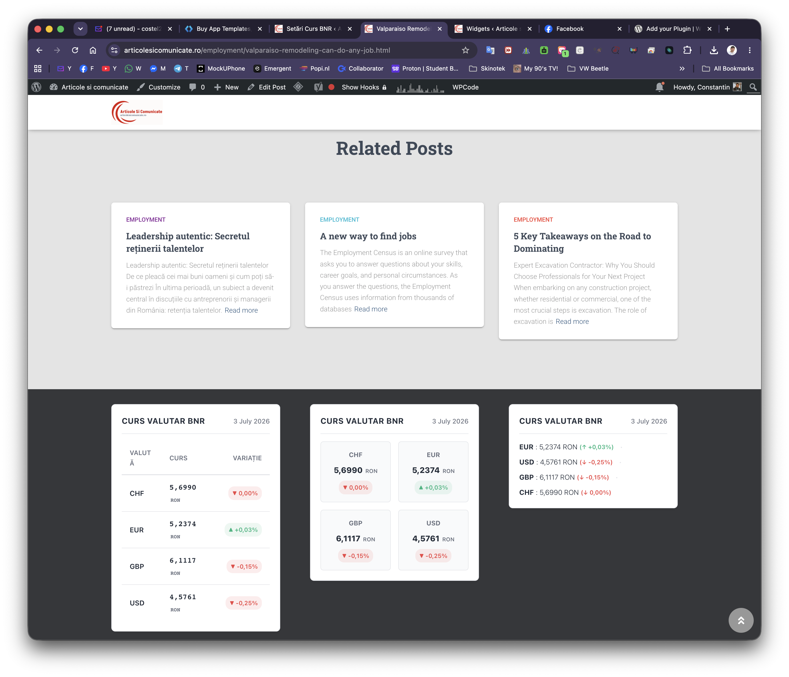
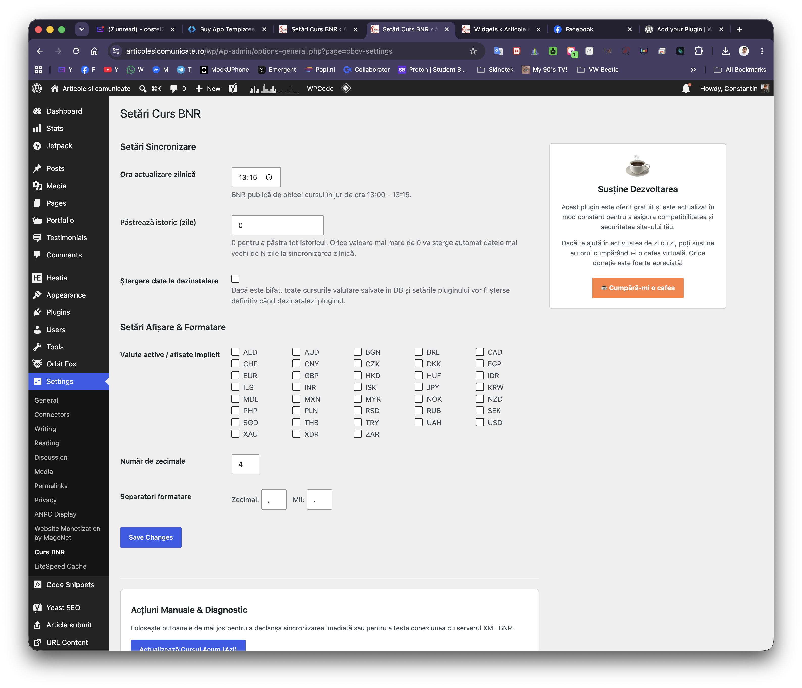
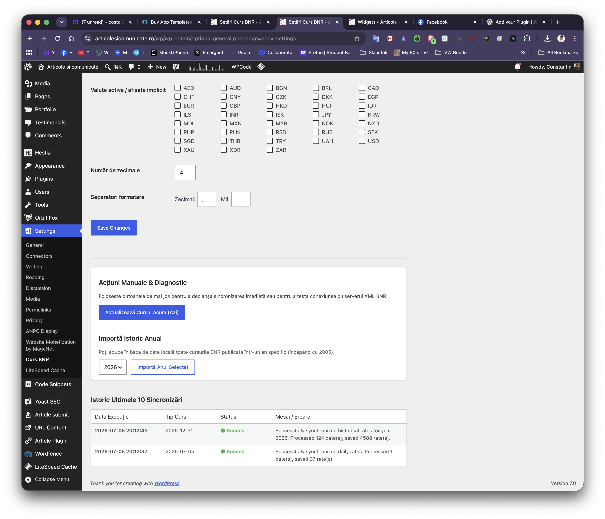
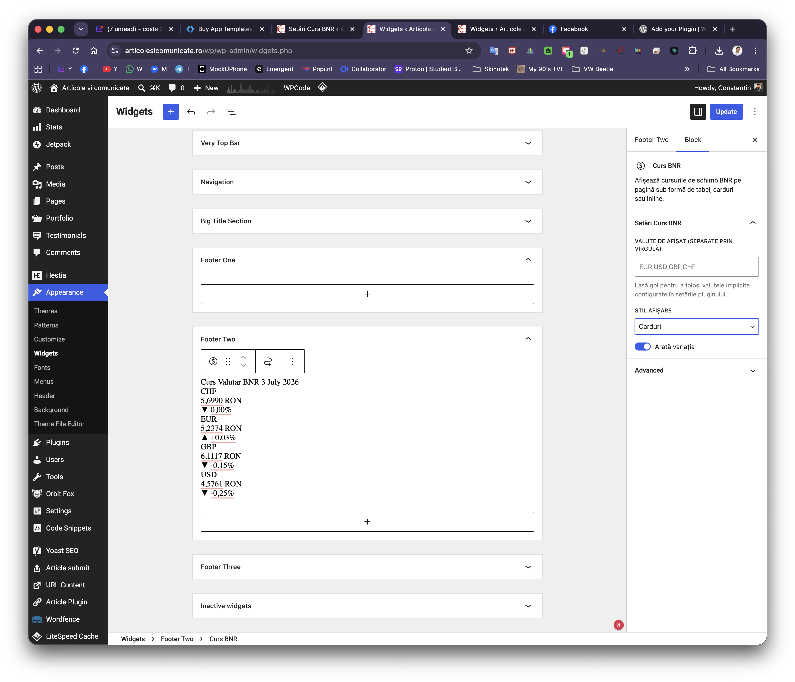

# 🏦 Onu Exchange Rates and Converter for BNR

<div align="center">

[](https://wordpress.org/plugins/curs-bnr-convertor-valutar/)
[](https://wordpress.org)
[](https://php.net)
[](https://www.gnu.org/licenses/gpl-2.0.html)

**Official daily BNR exchange rates, currency converter, Gutenberg block, and Elementor widget — all in one WordPress plugin.**

[📦 WordPress.org](#installation) · [☕ Buy me a coffee](https://buymeacoffee.com/constantinonu) · [🐛 Report an issue](https://github.com/cloudsoft-ro/onu-exchange-rates-converter-bnr/issues)

</div>

---

## ✨ Features

| Feature | Details |
|---|---|
| 📡 **Auto-fetch** | Daily rates from the official BNR XML feed via WP Cron |
| 🗄️ **Historical data** | Full history stored in a custom database table — query any past date |
| 💱 **Currency converter** | Interactive calculator with RON as the pivot currency |
| 📈 **Historical Chart** | Interactive SVG graph widget (7 days, 1 month, 3 months, 1 year, 5 years) |
| 📊 **Trend badges** | Color-coded daily variation indicators (increase / decrease) |
| ⚙️ **Shortcodes** | `[onuexra_curs]`, `[onuexra_convertor]`, and `[onuexra_grafic]` |
| 🧱 **Gutenberg block** | Native block with live Server-Side Render preview in the editor |
| 🎨 **Elementor widget** | Loaded conditionally only if Elementor is active |
| 🔲 **Classic widget** | Standard WordPress sidebar/footer widget |
| 🔒 **Security-first** | WPCS compliant, prepared SQL queries, nonce verification, output escaping |

---

## 📸 Screenshots

| Shortcode display | Admin settings | Rates table & sync | Gutenberg block |
|:---:|:---:|:---:|:---:|
|  |  |  |  |

---

## 🚀 Installation

### From WordPress Admin
1. Go to **Plugins → Add New**
2. Search for **"Onu Exchange Rates BNR"**
3. Click **Install Now**, then **Activate**

### Manual
1. Download the latest `.zip` from [Releases](https://github.com/cloudsoft-ro/onu-exchange-rates-converter-bnr/releases)
2. Upload to `/wp-content/plugins/` and extract
3. Activate from **Plugins → Installed Plugins**

### After activation
1. Go to **Settings → BNR Exchange Rates**
2. Select the currencies you want to display
3. Set the daily update time (default: **13:15**, when BNR publishes rates)
4. Use a shortcode, block, or widget to display rates on your site

---

## 🧰 Usage

### Shortcodes

**Display exchange rates:**
```
[onuexra_curs]
[onuexra_curs valute="EUR,USD,GBP" stil="card" arata_variatie="da"]
```

| Attribute | Values | Default |
|---|---|---|
| `valute` | Comma-separated currency codes | Configured in settings |
| `stil` | `tabel`, `card`, `inline` | `tabel` |
| `arata_variatie` | `da`, `nu` | `da` |

**Display currency converter:**
```
[onuexra_convertor]
```

**Display exchange rates chart:**
```
[onuexra_grafic]
[onuexra_grafic valuta="EUR" perioada="1luna" comutator_perioade="da" inaltime="320"]
```

| Attribute | Values | Default | Description |
|---|---|---|---|
| `valuta` | 3-letter currency code (e.g. `EUR`, `USD`, `GBP`) | `EUR` | Default charted currency |
| `perioada` | `7zile`, `1luna`, `3luni`, `1an`, `5ani` | `1luna` | Default timeframe range |
| `comutator_perioade` | `da`, `nu` | `da` | Show 7Z / 1L / 3L / 1A / 5A buttons |
| `comutator_valute` | `da`, `nu` | `da` | Allow visitor to switch currency |
| `valute` | Comma-separated currency codes | `EUR,USD,GBP,CHF` | Currencies in the dropdown |
| `titlu` | Text | Empty | Custom chart title |
| `inaltime` | Number (pixels, 180-600) | `300` | Chart height |
| `tema` | `implicit`, `light`, `dark` | `implicit` | Theme style |
| `densitate` | `implicit`, `compact`, `normal`, `spacious` | `implicit` | Layout padding |

### REST API

The plugin exposes a public REST API:

```
GET /wp-json/onuexra/v1/rates?date=2026-07-09
GET /wp-json/onuexra/v1/convert?amount=100&from=EUR&to=USD&date=2026-07-09
GET /wp-json/onuexra/v1/chart-data?currency=EUR&period=1luna
```

---

## 🏗️ Project Structure

```
curs-bnr-convertor-valutar/
├── curs-bnr-convertor-valutar.php    # Main plugin file
├── uninstall.php                      # Clean uninstall handler
├── readme.txt                         # WordPress.org readme
├── package.json                       # Node.js build config
│
├── assets/
│   ├── css/onuexra-style.css          # Frontend stylesheet
│   └── js/onuexra-convertor.js        # Converter calculator JS
│
├── blocks/
│   ├── curs-valutar/                  # Exchange rates Gutenberg block
│   │   ├── block.json
│   │   └── src/                       # ← Uncompiled human-readable source
│   │       ├── index.js
│   │       ├── edit.js
│   │       ├── edit-convertor.js
│   │       └── save.js
│   └── convertor-valutar/             # Converter Gutenberg block
│       └── block.json
│
├── build/                             # Compiled Gutenberg assets (generated)
│
├── includes/
│   ├── class-onuexra-admin.php        # Settings page & admin UI
│   ├── class-onuexra-converter.php    # Currency conversion logic
│   ├── class-onuexra-cron.php         # WP Cron scheduling
│   ├── class-onuexra-db.php           # Custom DB table & queries
│   ├── class-onuexra-elementor.php    # Elementor widget (conditional)
│   ├── class-onuexra-fetcher.php      # BNR XML fetcher & parser
│   ├── class-onuexra-rest.php         # REST API endpoints
│   ├── class-onuexra-shortcodes.php   # Shortcode rendering
│   └── class-onuexra-widget.php       # Classic WP widget
│
└── languages/                         # Translation template (.pot)
```

---

## 🛠️ Development

### Prerequisites
- Node.js ≥ 18
- npm ≥ 9
- PHP ≥ 7.4

### Setup

```bash
git clone https://github.com/cloudsoft-ro/onu-exchange-rates-converter-bnr.git
cd onu-exchange-rates-converter-bnr
npm install
```

### Build Gutenberg blocks

```bash
npm run build        # Production build
npm run start        # Development watch mode
```

### Deploy & package

```bash
npm run deploy
```

The deploy script will:
1. Prompt for version bump (optional)
2. Update `Version:` header and `ONUEXRA_VERSION` constant
3. Update `Stable tag` and add a Changelog entry in `readme.txt`
4. Compile Gutenberg block assets
5. Package everything into `dist/curs-bnr-convertor-valutar-vX.Y.Z.zip`

---

## 🌐 External Services

This plugin connects to the **National Bank of Romania (BNR)** XML feed:

| Endpoint | Purpose |
|---|---|
| `https://www.bnr.ro/nbrfxrates.xml` | Daily current rates |
| `https://bnr.ro/files/xml/years/nbrfxrates{YEAR}.xml` | Historical annual rates |

> **Privacy:** Only the exchange rate XML files are downloaded. No personal data, user information, or site data is transmitted to BNR.

- [BNR Website](https://www.bnr.ro/) · [Terms of Service](https://www.bnr.ro/Terms-and-conditions-12110.aspx) · [Privacy Policy](https://www.bnr.ro/Privacy-policy-12496.aspx)

---

## 📋 Supported Currencies (BNR)

`AED` `AUD` `BGN` `BRL` `CAD` `CHF` `CNY` `CZK` `DKK` `EGP` `EUR` `GBP` `HRK` `HUF` `INR` `JPY` `KRW` `MDL` `MXN` `MYR` `NOK` `NZD` `PHP` `PLN` `RSD` `RUB` `SEK` `THB` `TRY` `UAH` `USD` `XAU` `XDR` `ZAR`

---

## 📝 Changelog

### 1.0.1
- Resolved WordPress Plugins Team manual review feedback
- Renamed all prefixes from `cbcv` to unique `onuexra` to prevent conflicts
- Uncompiled Gutenberg block source files (`src/`) now bundled in release ZIP
- Enhanced `register_setting()` sanitization with BNR currency whitelist validation
- REST API routes updated to `onuexra/v1`
- Database table renamed to `wp_onuexra_exchange_rates`

### 1.0.0
- Initial release

---

## 📄 License

[GPLv2 or later](https://www.gnu.org/licenses/gpl-2.0.html) © [Constantin Onu](https://buymeacoffee.com/constantinonu)

---

<div align="center">

If this plugin saves you time, consider supporting its development:

[](https://buymeacoffee.com/constantinonu)

</div>
